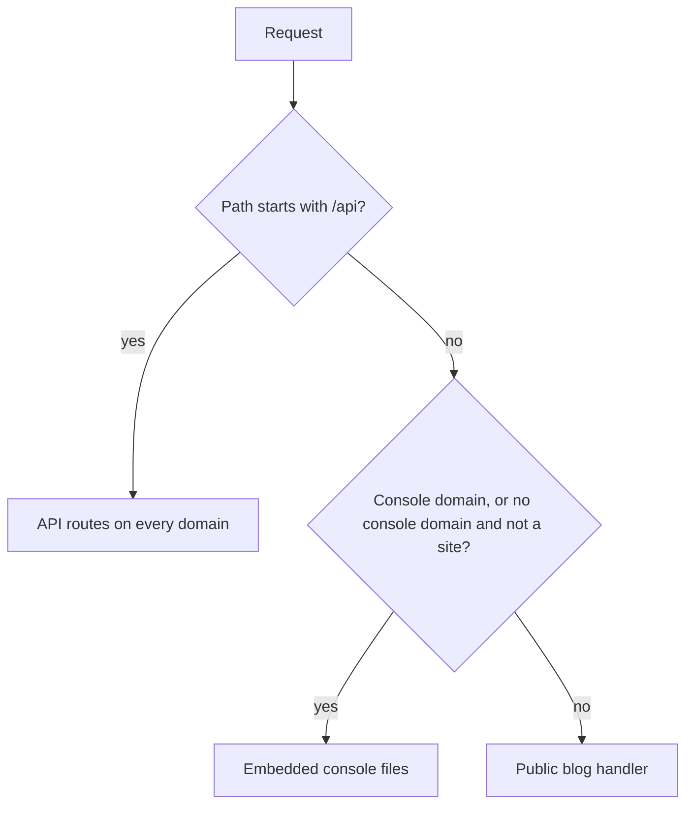
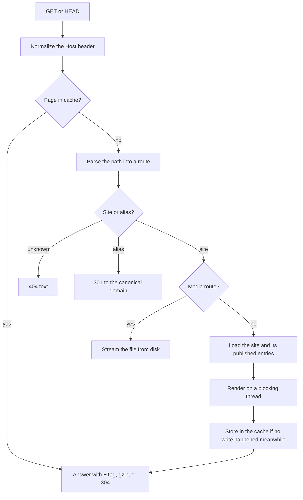
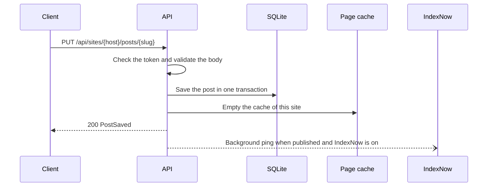

# How Cuhlumn works

Cuhlumn is one Rust process with an HTTP router, a SQLite database, a media folder, and an in-memory page cache.
This page explains how a request becomes an answer.

## Components

| Component | Technology | Role |
| --- | --- | --- |
| HTTP server | axum and tokio | Routes requests by path and by domain |
| Database | SQLite through rusqlite | Stores sites, aliases, posts, media records, sessions, server settings, and the font list |
| Media store | Files on disk | Stores uploaded images by content hash |
| Font library | Files on disk | Stores fonts for share images in `fonts/` |
| Settings | Memory | Keeps the effective server settings: environment overrides first, then database values |
| Page cache | Memory | Keeps rendered pages until the next write to the site, or until the next announcement boundary |
| Renderer | maud, pulldown-cmark, and syntect | Builds HTML pages, highlighted code, and crawler files |
| Share images | resvg | Draws PNG cards from an SVG layout |
| IndexNow client | reqwest | Sends new post addresses to search engines, for sites that have IndexNow on |
| Console | Preact app embedded in the binary | Serves the management interface |

## Routing

## Public request

The server renders each entry's Markdown at most once for each page build.
Share images are drawn on a blocking thread, so a slow render does not block other requests.

## Writes

The cache keeps a generation number for each site.
A write increases the number, so a page that was rendered before the write is not stored.

## Settings

The server reads the token, the console domain, and the scheme from the environment at startup.
A value that the environment does not set comes from the `settings` table.
After each change through the API, the server loads the settings again.
The database stores only the SHA-256 digest of the token.
Session hashes come from the token digest, so a new token ends every session.

## Validation

The `cuhlumn-api` crate defines every request and response type.
Each value type checks its rules when the server reads the JSON, so invalid data never reaches the database.
The same crate generates the TypeScript types of the console.

## Storage

The database runs in WAL mode with one connection.
Database calls run on the blocking thread pool.
Media files are written to a temporary file and renamed, so a reader never sees a partial file.
