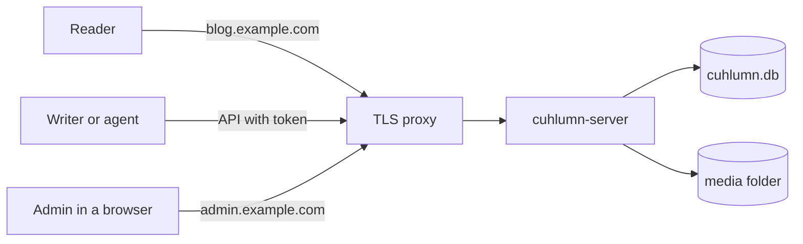

# Getting started

Cuhlumn runs as one server process.
The server reads the `Host` header of each request to decide which blog to show.

## Steps

1. [Install](installation.md) the server with Docker or from source.
2. Point each blog domain and the console domain at the server.
3. Put a TLS proxy in front of the server that passes the `Host` header.
4. Follow the [quick start](quickstart.md) to create a blog and publish a post.

## Concepts

| Term | Meaning |
| --- | --- |
| Site | One blog with one canonical domain |
| Alias | Another domain of a site that redirects to the canonical domain |
| Post | A dated article that appears in the post list and the feed |
| Page | An undated entry, such as About, that appears in the header |
| Draft | A saved post or page that readers cannot see |
| Admin token | The secret in `CUHLUMN_TOKEN` that gives access to every site |
| Console domain | The domain in `CUHLUMN_CONSOLE_HOST` that serves the management console |
