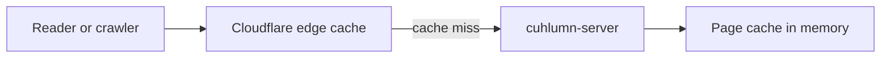

# Cloudflare

We recommend Cloudflare in front of every Cuhlumn blog domain.
Cloudflare serves cached pages from locations near the readers, so most requests never reach the server.
It also gives TLS, Brotli compression, and protection against traffic spikes.



Cuhlumn has two cache layers that work together:

| Layer | Holds a page until |
| --- | --- |
| Server page cache | The next write to the site |
| Cloudflare edge cache | The `max-age` of the response ends |

## Why a cache rule is necessary

By default, Cloudflare caches files by extension only.
The default list contains images such as `.png`, `.svg`, `.webp`, `.avif`, `.gif`, and `.jpg`, and also `robots.txt`.
Cloudflare does not cache HTML, `.xml`, `.md`, or `.txt` files by default, even with a `Cache-Control` header.
Without a cache rule, every page view of a post goes to the server.

## Setup

### 1. Add the domains

1. Add each blog domain and each alias to Cloudflare.
2. Make each DNS record proxied, so the orange cloud is on.
3. Point the records at the server, or use a [Cloudflare Tunnel](#cloudflare-tunnel-with-compose).

The console domain can also go through Cloudflare.
The cache rule below excludes it.

#### Cloudflare Tunnel with Compose

The `tunnel` profile of `docker-compose.yml` starts `cloudflared` next to the server.
The tunnel starts after the server health check passes.

1. In the Cloudflare dashboard, create a tunnel and copy its token.
2. Set `CLOUDFLARE_TUNNEL_TOKEN` in `.env` to the token.
3. Add a public hostname for each blog domain, each alias, and the console domain.
4. Send the traffic of each hostname to `http://cuhlumn:8080`.
5. Start the stack with `docker compose --profile tunnel up -d`.

With the tunnel, the server port does not need to be open to the internet.

### 2. Configure TLS

1. Set the SSL/TLS mode to **Full (strict)** when the server has its own TLS proxy with a valid certificate.
2. Turn on **Always Use HTTPS**.
3. Keep the scheme setting at `https`, which is the default.

With a Cloudflare Tunnel, the tunnel encrypts the connection, and the server can listen on plain HTTP.

### 3. Create the cache rule

Go to **Caching** > **Cache Rules** and create one rule.

| Setting | Value |
| --- | --- |
| Rule name | `Cuhlumn pages` |
| Expression | See below |
| Cache eligibility | **Eligible for cache** |
| Edge TTL | **Use cache-control header if present, bypass cache if not** |
| Browser TTL | **Respect origin** |

Use **Edit expression** and enter this expression with your console domain:

```text
not starts_with(http.request.uri.path, "/api/") and http.host ne "admin.example.com"
```

The expression makes every blog page eligible for cache.
It never caches the API or the console.

### 4. Check the bot settings

Cuhlumn exists so that search engines and AI assistants can read the blogs.
Make sure that these Cloudflare settings do not work against that:

- **Block AI bots** must be off, or AI crawlers cannot read the pages.
- **Managed robots.txt** must be off, or Cloudflare changes the `robots.txt` that Cuhlumn writes.

## How the Cuhlumn headers work with the rule

The rule tells Cloudflare to follow the `Cache-Control` header of each response.

| Response | `Cache-Control` | Result at the edge |
| --- | --- | --- |
| HTML pages | `public, max-age=60` | Cached for 1 minute |
| Feed, sitemap, `robots.txt`, `llms.txt`, Markdown copies, key file | `public, max-age=300` | Cached for 5 minutes |
| Share images and `favicon.svg` | `public, max-age=86400` | Cached for 1 day |
| Media files | `public, max-age=31536000, immutable` | Cached for 1 year |
| Redirects and 404 pages | None | Not cached |
| API and console | Excluded by the rule | Not cached |

Public pages never set cookies, so Cloudflare can store every public response.
Each response also has an `ETag`, so Cloudflare can check a stale page with a cheap `304` request.

## Changes and freshness

Cuhlumn does not purge the Cloudflare cache.
After a write, the edge shows the old version until the `max-age` ends:

- A new or changed post appears within 1 minute.
- An unpublished post disappears within 1 minute.
- The feed, the sitemap, and `llms.txt` update within 5 minutes.

Media files never change, because a new image gets a new name.
Share image addresses contain a `?v=` version, and the Cloudflare cache key contains the query string.
A changed site or post therefore gets a new share image immediately.

`/favicon.svg` has no version and stays cached for up to 1 day.
After you change the accent color or the site title, purge `/favicon.svg` in Cloudflare if the new icon must show immediately.

## Longer edge caching

You can keep pages longer at the edge with **Ignore cache-control header and use this TTL**, for example 1 hour.
Then Cloudflare shows changes only after that time, or after a manual purge.
Purge the site after each publish if you use this setting.
The default rule above keeps changes visible within 1 minute and still serves most traffic from the edge.

## Check the cache

Send the same request twice and read the `cf-cache-status` header:

```sh
curl -sI https://blog.example.com/ | grep -i cf-cache-status
curl -sI https://blog.example.com/ | grep -i cf-cache-status
```

The first answer can be `MISS` or `EXPIRED`.
The second answer is `HIT`.
`DYNAMIC` means that the cache rule does not match the request.
