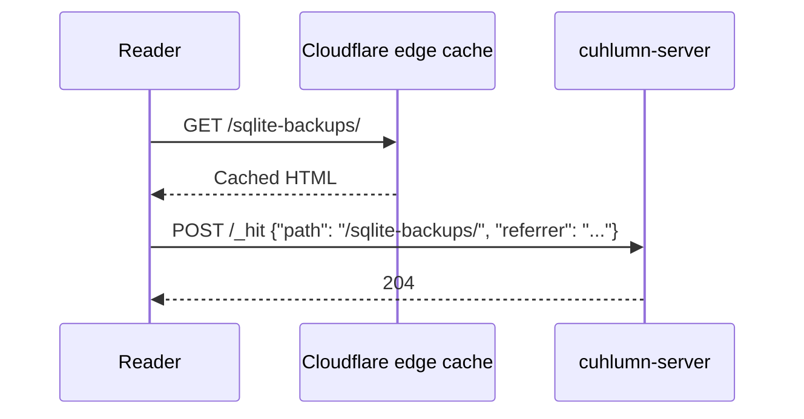

# Analytics

Cuhlumn counts the page views and the daily visitors of each blog.
The console shows the numbers in the **Analytics** tab of each site.
The counts use no cookies, no `localStorage`, and no third-party service, and the server never stores IP addresses.

## How a view is counted

Each HTML page contains a small inline script at the end of `<body>`.
The script sends one request to `POST /_hit` on the blog domain when the page loads.



The HTML is the same for every reader, so the server page cache and the [Cloudflare](../operations/cloudflare.md) edge cache keep working.
Cloudflare never caches `POST` requests, so every view reaches the server.

The script sends no request in these cases:

- The browser is automated, for example a test runner. The script checks `navigator.webdriver`.
- The browser prerenders the page and the reader does not open it.

## What counts

The server counts a request to `/_hit` as a view only when all of these conditions are true:

- The domain is the main domain of a site. An alias does not count, because alias pages redirect.
- The path is `/`, a published post or page (`/{slug}/`), or a tag page with at least one published post.
- The `User-Agent` header is not empty and does not look like a bot or a command-line tool.

A reload counts as a new view.
The server answers `204` also when it ignores a request.

## Visitors

A visitor is a daily unique combination of the client IP address and the `User-Agent` header.
The server makes a hash of a random daily key, the domain, the IP address, and the `User-Agent` header.
It keeps the hash for the current day only, to count each visitor once.

- The server makes a new random key when the UTC day changes.
- At that time, the server deletes the old key and all hashes of the old day.
- The server never stores the IP address.

A person who comes back on the next day is a new visitor.
The visitor total of a period is therefore the sum of the daily visitors.

## Reports

| Report | Contents |
| --- | --- |
| Views and visitors | The totals of the period and one value for each day |
| Top pages | The 10 pages with the most views, with the post title |
| Top referrers | The 10 referring domains with the most views |
| Devices | Desktop, mobile, and tablet |
| Browsers | Chrome, Safari, Firefox, Edge, Opera, Samsung Internet, and other browsers |

The periods are the last 7, 30, 90, and 365 days, today included.
Days start at 00:00 UTC.
The server keeps the daily totals until you delete the site.

A referrer is stored as the domain only, without `www.`, the path, or the query.
A referrer on the same domain as the blog counts as a direct visit.
A visit without a referrer also counts as direct.

## Client IP address behind a proxy

The server reads the client IP address from the first header in this list that is present:

1. `CF-Connecting-IP`, which Cloudflare sets
2. `X-Real-IP`
3. The last entry of `X-Forwarded-For`
4. The address of the connection

Behind your own reverse proxy, send the client address to the server.
Otherwise, every reader has the address of the proxy, and visitors are counted by `User-Agent` only.
For nginx, add this line to the `location` block:

```nginx
proxy_set_header X-Real-IP $remote_addr;
```

## Delays and limits

- The server collects the counts in memory and writes them to the database every minute.
- The analytics route writes the pending counts first, so the console always shows the current numbers.
- A normal shutdown writes the pending counts. A crash loses the counts of the last minute.
- Readers who block scripts or turn off JavaScript are not counted.
- Anyone can send requests to `/_hit`, so a sender can inflate the counts.
- Bots that run JavaScript and send the `User-Agent` of a browser count as readers.

See [Analytics](../reference/analytics.md) in the API reference for the route and the response.
