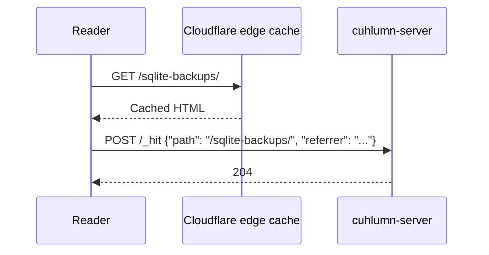

# Analytics

Cuhlumn counts the page views, the daily visitors, and the link clicks of each site.
A site is a blog that the server serves, or an [external site](#external-sites) that a different server serves.
The console shows the numbers in the **Analytics** tab of each site.
The counts use no cookies, no `localStorage`, and no third-party service, and the server never stores IP addresses.

## How a view is counted

Each HTML page of a blog contains a small inline script at the end of `<body>`.
The script sends one request to `POST /_hit` on the blog domain when the page loads.



The HTML is the same for every reader, so the server page cache and the [Cloudflare](../operations/cloudflare.md) edge cache keep working.
Cloudflare never caches `POST` requests, so every view reaches the server.

The script sends no request in these cases:

- The browser is automated, for example a test runner. The script checks `navigator.webdriver`.
- The browser prerenders the page and the reader does not open it.

The script also sends one request when a page changes its address path without a page load.
Documentation themes with instant navigation change pages in this way.
A change of only the query or the fragment sends no request.

## What counts

The server counts a request to `/_hit` as a view of a blog only when all of these conditions are true:

- The domain is the main domain of a blog. An alias does not count, because alias pages redirect.
- The path is `/`, a published post or page (`/{slug}/`), or a tag page with at least one published post.
- The `User-Agent` header is not empty and does not look like a bot or a command-line tool.

A reload counts as a new view.
The server answers `204` also when it ignores a request.

## External sites

An external site is a website that Cuhlumn does not serve, for example a static documentation site.
Cuhlumn counts its page views and its link clicks, and shows them in the same reports as the blogs.
The server serves no pages, feeds, sitemaps, or redirects for the domain of an external site.

### Register the site

Create a site with `kind` set to `external`.
The site domain is the exact host name that the browser shows for the website, without a port.
`docs.example.org` and `www.docs.example.org` are two different sites.

```sh
curl -X PUT https://blog.example.com/api/sites/docs.example.org \
  -H "Authorization: Bearer $CUHLUMN_TOKEN" \
  -H "Content-Type: application/json" \
  -d '{"title": "Harbor Docs", "kind": "external"}'
```

With the command-line client, the command is:

```sh
echo '{"title": "Harbor Docs", "kind": "external"}' | cuhlumn --site docs.example.org site apply -
```

- An external site uses only `title`. The server stores the other site settings, but does not use them.
- An external site cannot have aliases, posts, pages, or images.
- The kind of a site cannot change. To change it, delete the site and create it again.
- `DELETE /api/sites/{host}`, or `cuhlumn site delete --yes`, removes the site with all its counts.

### Add the script

Add this tag to every page of the external site.
Replace `blog.example.com` with the main domain of a blog that your server serves.

```html
<script async src="https://blog.example.com/_hit.js"></script>
```

- The file is the same script that blog pages contain. It has less than 1 KB.
- The script sends its requests to the server that it comes from, not to the external site.
- The address is the same in every version, and browsers and proxies can keep the file for 1 day.
- Only the main domain of a blog serves the file. An alias redirects, and the console domain does not serve it.
- The tag must be a classic script. Do not use `type="module"`, and do not copy the script into the page.
- Do not let a build tool copy the file to the external site, because the script then sends its requests to the wrong server.
- A Content Security Policy of the external site must allow the blog domain in `script-src` and in `connect-src`.

With Zensical or MkDocs, add the address to `extra_javascript` in the configuration instead of the tag.

### What counts for an external site

The server counts a request as a view of an external site only when all of these conditions are true:

- The request body names the domain of a registered external site in `host`. The script sends `location.hostname`.
- The `Origin` header of the request names the same domain.
- The path starts with `/`, has no control characters, and has at most 256 bytes.
- The `User-Agent` header is not empty and does not look like a bot or a command-line tool.

The browser sets the `Origin` header, and a page script cannot change it.
A page on a different website therefore cannot add views to your external site.
The request is a simple cross-origin `POST`, so the browser sends no CORS preflight request.

The server cannot know which pages an external site has.
It stores each path without the query and the fragment, and it decodes the percent-encoding.
A referrer on the domain of the external site counts as a direct visit.
The visitor hash uses the domain of the external site.

### Limits for external sites

- The server stores at most 1,000 different paths for each external site and UTC day.
- A view of a further path counts in the views, visitors, referrers, devices, and browsers, but not in the page list.
- A view with a path that is longer than 256 bytes does not count.
- A page with the `Referrer-Policy` value `no-referrer` or `same-origin` makes the browser send `Origin: null`. Its views do not count.
- A program that is not a browser can send any `Origin` header. Such a sender can inflate the counts, as for a blog.

## Link clicks

The script counts a click on a link with an `http` or `https` address in these cases:

| Kind | Condition |
| --- | --- |
| Outbound | The host name of the link is different from the host name of the page |
| Download | The link has a `download` attribute, or its path ends in one of the extensions below |

The download extensions are `.zip`, `.gz`, `.tgz`, `.bz2`, `.xz`, `.7z`, `.rar`, `.whl`, `.jar`, `.exe`, `.msi`, `.dmg`, `.pkg`, `.deb`, `.rpm`, `.apk`, `.iso`, `.pdf`, `.epub`, `.doc`, `.docx`, `.xls`, `.xlsx`, `.ppt`, and `.pptx`.
A path that ends in `.tar.gz` therefore counts.
The comparison ignores uppercase and lowercase.

- A click that is outbound and a download counts one time, as a download.
- A click with the primary button, a click with the middle button, and a click with a modifier key all count.
- A link that the reader opens from the context menu does not count.
- The script does not delay, stop, or change the navigation.
- The script sends the click with `navigator.sendBeacon`, so the navigation does not cancel the request.

The server stores the kind and the target of each click.
The target is the host name and the path of the link, for example `github.com/EzyGang/cuhlumn`.
It has no scheme, no port, no query, and no fragment.
The server never receives or stores the link text.

A click is not a view.
It changes no view count and no visitor count, and the server makes no visitor hash for it.

The server counts clicks for blogs and for external sites.
The rules for the domain, the `Origin` header, and the `User-Agent` header are the same as for views.

### Limits for link clicks

- A target that is longer than 256 bytes does not count.
- The server stores at most 1,000 different targets for each site and UTC day, for both kinds together.
- A click on a further target does not count.
- An outbound click to the domain of the site itself does not count.

## Visitors

A visitor is a daily unique combination of the client IP address and the `User-Agent` header.
The server makes a hash of a random daily key, the domain, the IP address, and the `User-Agent` header.
It keeps the hash for the current day only, to count each visitor once.

- The server makes a new random key when the UTC day changes.
- At that time, the server deletes the old key and all hashes of the old day.
- The server never stores the IP address.

A person who comes back on the next day is a new visitor.
The visitor total of a period is therefore the sum of the daily visitors.

## Reports

| Report | Contents |
| --- | --- |
| Views and visitors | The totals of the period and one value for each day |
| Top pages | The 10 pages with the most views, with the post title. An external site shows the path only |
| Top referrers | The 10 referring domains with the most views |
| Devices | Desktop, mobile, and tablet |
| Browsers | Chrome, Safari, Firefox, Edge, Opera, Samsung Internet, and other browsers |
| Outbound link clicks | The 10 outbound targets with the most clicks |
| Download clicks | The 10 download targets with the most clicks |

The periods are the last 7, 30, 90, and 365 days, today included.
Days start at 00:00 UTC.
The server keeps the daily totals until you delete the site.

A referrer is stored as the domain only, without `www.`, the path, or the query.
A referrer on the same domain as the site counts as a direct visit.
A visit without a referrer also counts as direct.

`cuhlumn analytics` prints the same report as JSON.

## Client IP address behind a proxy

The server reads the client IP address from the first header in this list that is present:

1. `CF-Connecting-IP`, which Cloudflare sets
2. `X-Real-IP`
3. The last entry of `X-Forwarded-For`
4. The address of the connection

Behind your own reverse proxy, send the client address to the server.
Otherwise, every reader has the address of the proxy, and visitors are counted by `User-Agent` only.
For nginx, add this line to the `location` block:

```nginx
proxy_set_header X-Real-IP $remote_addr;
```

## Delays and limits

- The server collects the counts in memory and writes them to the database every minute.
- The analytics route writes the pending counts first, so the console always shows the current numbers.
- A normal shutdown writes the pending counts. A crash loses the counts of the last minute.
- Readers who block scripts or turn off JavaScript are not counted.
- Anyone can send requests to `/_hit`, so a sender can inflate the counts.
- Bots that run JavaScript and send the `User-Agent` of a browser count as readers.

See [Analytics](../reference/analytics.md) in the API reference for the routes and the response.
